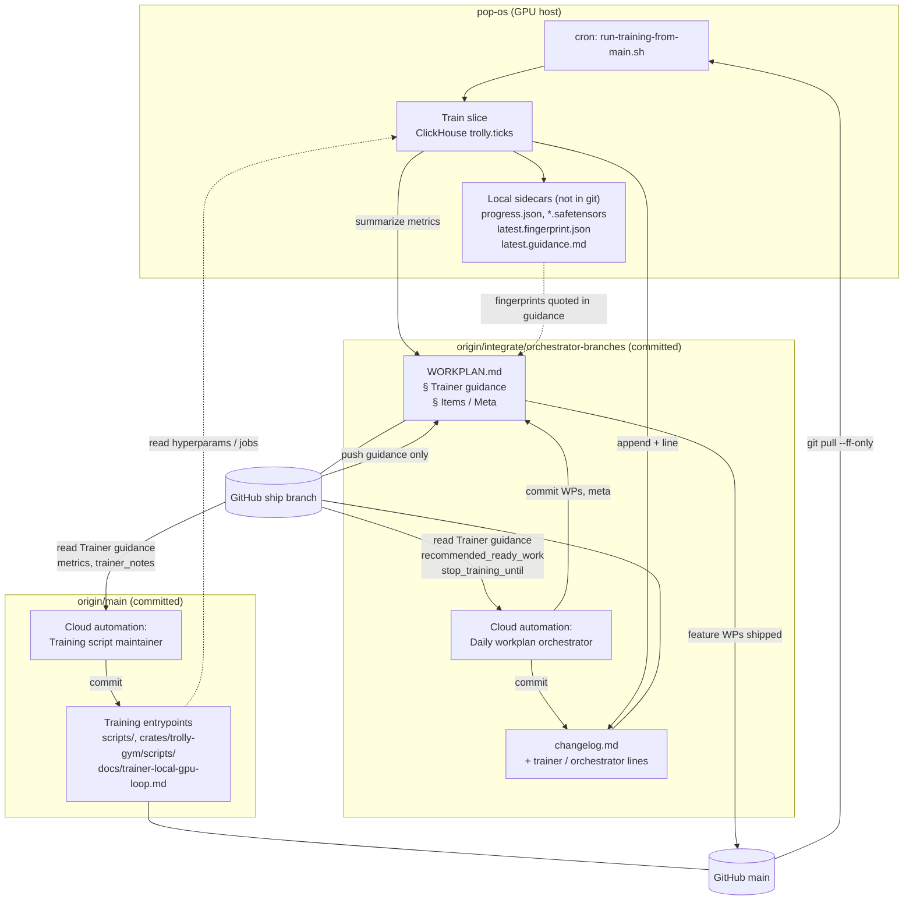

# GPU training ↔ orchestration feedback (committed artifacts)

Host cron trains on pop-os; cloud automations edit training tooling on `main` and schedule feature work from the ship branch. **Metrics and decisions flow through git commits**, not ad-hoc chat.

## Diagram



## Committed files (feedback contract)

| File | Branch | Writer | Reader(s) | Carries |
|------|--------|--------|-----------|---------|
| `WORKPLAN.md` → **Trainer guidance** | `integrate/orchestrator-branches` | Local GPU trainer | Orchestrator automation, Training script automation | `device`, `duration_secs`, `ticks`, fingerprint SHAs, `metrics`, `vs_broad_goal`, `stop_training_until`, `recommended_ready_work`, `do_not_schedule`, `trainer_notes` |
| `WORKPLAN.md` → **Items / Meta** | ship branch | Orchestrator automation | Orchestrator (next wave), humans | WP status, `depends_on`, scopes, `last_run`, `ship_branch` |
| `changelog.md` | ship branch | Trainer + orchestrator | Both automations (recency context) | `+` lines per slice/run, WIP trim |
| Training scripts & `docs/trainer-local-gpu-loop.md` | `main` | Training script automation | Host cron / trainer | CLI flags, `TROLLY_TRAIN_*` defaults, ingest paths, duration hooks |
| `docs/gpu-train-orchestration-flow.md` | `main` | Humans / agents | Onboarding | This diagram |

**Not committed (host-only):** checkpoints, `latest.safetensors`, ClickHouse data, `.env`. Fingerprints in guidance **cite** local SHAs; orchestration does not clone weights from git.

## Automation read order

### Training script maintainer (cloud, `main`)

1. `git fetch`; read latest **`WORKPLAN.md` Trainer guidance** on `origin/integrate/orchestrator-branches` (or ship checkout in prompt).
2. If `stop_training_until` names a code gap → change scripts/config on `main`, not longer slices.
3. If `trainer_notes` or metrics show ingest/reward mismatch → adjust training entrypoints, env docs, or `TROLLY_TRAIN_JOBS` defaults.
4. Commit to `main`; host picks up on next cron pull.

### Daily workplan orchestrator (cloud, ship branch)

1. `git fetch`; rebase ship branch onto `origin/main`.
2. Read **Trainer guidance** (overwrite section; single source of truth).
3. Honor `do_not_schedule` and `stop_training_until`.
4. Schedule `recommended_ready_work` / ready WPs; do **not** open GPU training chores when guidance says the bottleneck is interface/code, not hours.
5. Push ship branch; append orchestrator `changelog.md` line.

### Local GPU trainer (pop-os)

1. Pull `main` (scripts).
2. Train; update local sidecars.
3. Rewrite Trainer guidance from **this slice’s metrics** (and prior sidecars if skipping train due to lock).
4. Push **only** guidance + changelog on ship branch.

## Closed loop (one cycle)

```text
main (scripts) ──pull──► train ──metrics──► ship: Trainer guidance
       ▲                                        │
       │                                        ▼
       └── training automation reads guidance ──┤
                                                  ▼
                                         orchestrator reads guidance
                                                  │
                                                  ▼
                                         WPs + code on main / ship
```

See also: [`trainer-local-gpu-loop.md`](trainer-local-gpu-loop.md).